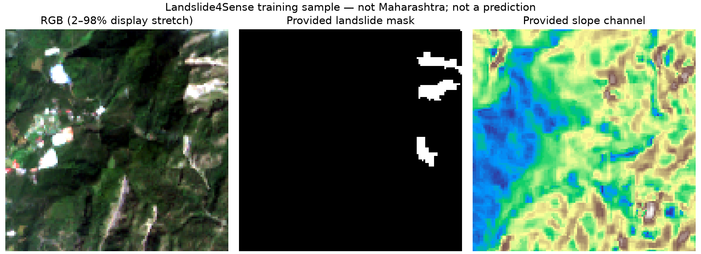

# Research implementation and dataset starter

Prepared 30 October 2026 for Dinesh Auti and collaborators.

## See and run the new addition

This module adds a data preparation demonstration and research plan to the atlas repository. It does not add a new trained model to the state/district dashboard.



**How to read the image:** left is satellite RGB; middle is the provided binary landslide mask (white = mapped landslide); right is the supplied slope channel. This is a training example, not a prediction or a Maharashtra map. Figure source: Landslide4Sense, [dataset DOI 10.5281/zenodo.10463239](https://doi.org/10.5281/zenodo.10463239), CC BY 4.0; training sample 1 from the pinned IBM-NASA mirror. Our preparation code selects RGB bands, applies a per-band 2–98% display stretch and renders the annotation/slope. Preserve this attribution when sharing the figure.

### Run on GitHub without a local Python installation

1. Open [Run research sample demonstration](https://github.com/dinesha-dsa/landslide-atlas/actions/workflows/research-demo.yml).
2. Select **Run workflow**, choose `main`, and confirm **Run workflow**. Write access is required; scholars without it can fork this repository and run the same workflow in their fork.
3. Open the resulting run and its **prepare-samples** job to watch the installation and data checks.
4. Once successful, download **landslide-research-demo** under **Artifacts** on the run page. It contains `sample_preview.png` and `download_report.json`. Artifact downloads require GitHub sign-in and expire after 30 days; rerun to regenerate them.

The workflow downloads only two small training examples (~3.7 MB), validates checksums and labels, and generates the image above. It does not download the full dataset, install a deep learning framework, or train U-Net. GitHub Actions availability and usage limits depend on the account and repository settings.

### What each new file does

| File | Purpose |
|---|---|
| `prepare_resources.py` | Downloads the examples, checks hashes and array contents, and renders a preview |
| `requirements.txt` | Records tested Python dependencies |
| `resources.json` | Pins sample URLs, checksums, PDF links and upstream code revision |
| `full_dataset_download_links.json` | Lists full dataset files, sizes and provider checksums |
| `VALIDATION.md` | Records completed checks and the research work still outstanding |
| `example_preview.png` | Shows actual supplied training data and annotation |
| `.github/workflows/research-demo.yml` (repository root) | Runs the sample demonstration on GitHub Actions |

## What can be implemented

Jiang, Ma and Mei (2026), *Deep learning for potential landslide identification: data, models, applications, challenges, and opportunities*, is a review, not one reproducible model. Its availability statements provide no original research data or software. Select and reproduce one of the underlying methods, then evaluate a clearly defined extension. The existing India review manuscript has not been edited by preparing this pack.

Recommended first experiment: reproduce a U-Net landslide segmentation baseline on Landslide4Sense; compare spectral inputs against spectral + slope + elevation inputs. This identifies landslide footprints visible in imagery. It does not, by itself, demonstrate future landslide susceptibility or pre-failure warning.

## Verified resources

| Resource | Official access | Contents and practical limit |
|---|---|---|
| Attached review, 2026 | https://nhess.copernicus.org/articles/26/487/2026/ | Open PDF linked below; CC BY 4.0 |
| Landslide4Sense | https://zenodo.org/records/10463239 | CC BY 4.0; about 3.10 GB compressed; 3,799 train, 245 validation, 800 test patches; 128 x 128 x 14; Sentinel-2 bands plus ALOS-derived slope/elevation |
| Official baseline code | https://github.com/iarai/Landslide4Sense-2022 | MIT; pinned upstream snapshot available through the downloader. Inspect dependencies and code before execution; older PyTorch environment needs adaptation |
| Landslide4Sense reference paper | https://arxiv.org/abs/2206.00515 | Author preprint linked below |
| HR-GLDD | https://zenodo.org/records/7189381 | CC BY 4.0; about 576.1 MB; labelled NumPy arrays; PlanetScope RGB + NIR at 3 m; includes Kodagu, Karnataka, a useful Western Ghats connection, not a Maharashtra dataset |
| HR-GLDD reference paper | https://essd.copernicus.org/articles/15/3283/2023/ | Open final PDF linked below |
| HR-GLDD code/data repository | https://github.com/kushanavbhuyan/HR-GLDD-A-Global-Landslide-Mapping-Data-Repository | Inspect site/event identifiers before claiming geographic independence |
| CAS Landslide Dataset | https://doi.org/10.5281/zenodo.10294997 | Dataset DOI linked by the primary paper; full files/license not audited in this starter |
| CAS reference paper | https://www.nature.com/articles/s41597-023-02847-z | Describes image/label/mask tiles, 512 x 512 pixels |
| Sentinel-1 mission/data documentation | https://documentation.dataspace.copernicus.eu/Data/SentinelMissions/Sentinel1.html | Use SLC and an appropriate InSAR workflow for displacement; GRD is not an interferometric phase product |
| Sentinel-2 collection | https://dataspace.copernicus.eu/data-collections/copernicus-sentinel-missions/sentinel-2 | Source for dated Maharashtra optical imagery; cloud and temporal coverage need checking |
| GSI Bhusanket | https://bhusanket.gsi.gov.in/ | Official Indian landslide information; inspect available inventory exports, permissions, dates and geometry before use |

### Sample provenance and limitations

Only two TRAINING image/mask pairs are requested from the public IBM-NASA mirror, pinned at revision `4b291891badf301b5c75c2153f0f8fe00eeb1435`:
https://huggingface.co/datasets/ibm-nasa-geospatial/Landslide4sense

They are examples, not an evaluation dataset. Original official Landslide4Sense validation/test masks were withheld. The mirror advertises annotations/counts beyond the original release; those partitions have not been validated here and must not be treated automatically as original held-out ground truth. Use official Zenodo releases and document any alternative provenance. Geographic/date metadata were withheld in the original competition; patch IDs alone cannot establish event-separated evaluation. A random training-patch holdout is an engineering check, not evidence of transfer to a new district or event.

The downloader verifies the four sample files against SHA-256 checksums from our 30 October 2026 audit. It checks HDF5 shapes, finite values and binary mask labels, and records stable source URLs, sizes and hashes in `downloads/download_report.json`. Signed CDN redirect URLs are not stored. An optional preview displays provided labels, not model predictions. Resampling to 10 m does not create native 10 m information in all source channels. No trained weights or accuracy results are supplied.

## Implementation sequence

1. Verify HDF5 shape, labels, missing values, band order and normalization in the samples. Download the full official training archive only when storage is available; verify the Zenodo checksum.
2. Inspect the baseline archive and preserve its MIT license. Create a separate modern Python/PyTorch environment; GPU availability and memory have not been checked in this pack. Use a fixed seed and record package versions.
3. Define the evaluation split before training. Fit normalization on training data only; keep overlapping tiles and known same-event tiles together. For meaningful geographic testing, obtain verified site/event metadata or a separate labelled dataset.
4. Train the baseline, then compare spectral-only versus terrain-enhanced inputs and simple pixel-level logistic regression/random forest baselines. Document sampling and class imbalance. Report precision, recall, F1/Dice, IoU and PR-AUC with event-level uncertainty where enough independent events exist; ROC-AUC alone is insufficient.
5. Prepare an independent Maharashtra inventory (initially Raigad/Raigarh): polygon footprints, event dates, mapping date, source, imagery acquisition times, confidence and license. Confirm labels against pre/post-event imagery and expert review. Known-absent/background areas require careful selection.
6. Freeze an external Maharashtra test set before tuning. Evaluate cross-region transfer and calibration; inspect performance by terrain, cloud coverage, mapped-area size and imagery date. Harmonize different bands/resolutions explicitly when using HR-GLDD; its four channels are not directly interchangeable with the fourteen-channel baseline.
7. A future susceptibility/precursor experiment requires exclusively pre-event predictors, dated outcomes, defined prediction horizon and temporal holdout. Add rainfall/InSAR only after coverage, temporal availability and label alignment are established. A terrain regularizer alone should not be described as a physics-informed neural network without a defensible governing formulation and parameters.

## Candidate contribution to investigate

An independently dated Maharashtra benchmark with explicit pre-event feature cutoffs, region/event-held-out transfer evaluation, uncertainty calibration, and tests of how missing/cloud-obscured modalities affect performance could provide a defensible research contribution. Its novelty remains to be checked against current literature. Reproducing U-Net alone is a baseline, not a novel contribution or a guarantee of journal acceptance.

## Download and verify examples

Use Python 3.12. Clone the repository and open this module directory:

```sh
git clone https://github.com/dinesha-dsa/landslide-atlas.git
cd landslide-atlas/research/landslide-segmentation
python -m venv .venv
```

Activate it on Windows PowerShell with `.\.venv\Scripts\Activate.ps1`; on Linux/macOS use `source .venv/bin/activate`. If local activation is restricted, invoke the environment's Python executable directly.

```sh
python -m pip install -r requirements.txt
python prepare_resources.py --preview
```

Default download: two training image/mask pairs (~3.7 MB). Files go into ignored `downloads/`. For papers and the official baseline snapshot:

```sh
python prepare_resources.py --papers --baseline --preview
```

This downloads public resources, validates the examples and generates a preview. It does not execute the upstream code, train a model, install PyTorch, or download full datasets. The baseline snapshot is pinned to commit `2df4c378cfc4a0feedf197826e769da520100d81`. Its MIT license remains inside the downloaded archive. Paper PDFs retain their publisher/author licenses; the repository MIT license does not apply to them.

Full dataset URLs, sizes and official MD5 checksums are in [full_dataset_download_links.json](full_dataset_download_links.json). Dataset downloads remain with their providers. File-level SHA-256 values for the small examples and PDFs are in [resources.json](resources.json). An upstream PDF update will require review and an explicit checksum update rather than silent acceptance.

## Direct paper PDFs

- Jiang et al. (2026), review: https://nhess.copernicus.org/articles/26/487/2026/nhess-26-487-2026.pdf
- Ghorbanzadeh et al. (2022), Landslide4Sense author preprint: https://arxiv.org/pdf/2206.00515
- Meena et al. (2023), HR-GLDD final paper: https://essd.copernicus.org/articles/15/3283/2023/essd-15-3283-2023.pdf

Please cite the original dataset and method authors when reusing their work. Acknowledging this starter does not replace those citations. The Jiang review is context, not the source of the Landslide4Sense model.

## Contribute research

Open a repository issue to discuss an experiment, or submit a pull request with code, data provenance, reproducible commands and evaluation limitations. Do not commit credentials, private field locations, manuscripts, large satellite archives or downloaded paper PDFs. Add a public data-source URL, license, date and checksum for proposed data additions. Proposed training implementations should document splits and leakage checks before reporting results.
